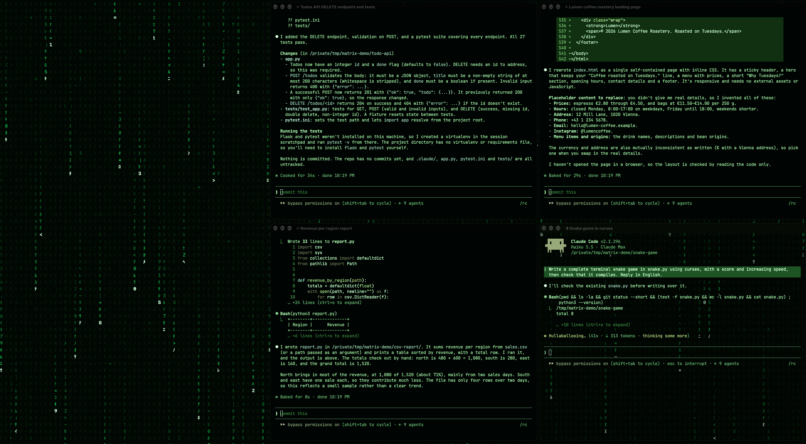

# Full Mac Claude Matrix Mode

Turn your Mac into a Matrix console while you run a bunch of Claude Code sessions in Ghostty, and still be able to actually work in it.



- **Every Ghostty window goes Matrix green**, but stays readable: higher contrast, slightly bolder text, and the focused window keeps most of its real colours (diffs stay red and green).
- **Code rain only where Claude is working.** While a session works, the falling code shows through behind its text. When Claude finishes or asks you something, the rain in that window stops. Calm windows are the ones waiting for you.
- **A green frame around the focused window**, so you always see where you type.
- **The browser gets covered with rain while you are not in it.** Click into it and you see the normal page again.
- **Windows tile themselves** into a grid that fits the screen (auto, 2×2, 3×2, 4×2, 4×3). On ultrawide screens the browser gets a strip on the left.
- **The menu bar hides, the desktop goes black.**
- **One key toggles everything** on and off, and off restores your normal Ghostty look.

## Requirements

- macOS 14 or newer
- [Ghostty](https://ghostty.org) 1.2+ (uses custom shaders and the `iFocus` uniform)
- Xcode Command Line Tools (`xcode-select --install`), the installer compiles a few small Swift binaries
- [Claude Code](https://claude.com/claude-code) for the working / waiting signal (everything else works without it)

## Install

```sh
git clone https://github.com/suorigo/full-mac-claude-matrix-mode
cd full-mac-claude-matrix-mode
./install.sh
```

Then start it with `open ~/Applications/Matrix.app` or press **ctrl+alt+cmd+M**.
On first start macOS asks for two permissions:

- **Accessibility** for Matrix.app (tiling windows and reloading the Ghostty config)
- **Input Monitoring** for `matrix-hotkey` (the global toggle key)

Remove everything again with `./uninstall.sh`.

## Different screens

Every time the mode turns on (or you pick *Re-tile windows*), it looks at the main screen and the Ghostty windows that are open:

- **Ultrawide** (wider than about 2.2 : 1): the browser gets a strip on the left (`browser=0.34` of the width), terminals fill the rest.
- **Normal screens and laptops**: the browser is left where it is, terminals fill the whole screen.
- **Automatic grid**: picks the number of columns so each window ends up close to a 1.45 : 1 shape. 4 windows on a MacBook become 2×2, 6 on an ultrawide become 3×2.
- **Fixed grid** (`grid=4x2` etc.) keeps every window the same size and leaves empty slots black, which is nice when sessions come and go. It is only used when it fits: all windows must fit, at most half of the slots may be empty and each slot must be at least 640 px wide. Otherwise it falls back to automatic, so a `4x2` setting from an ultrawide still gives a sensible 2×2 on a laptop with four windows.

## Settings

`~/.config/matrix-mode/config`:

```ini
grid=auto            # auto, 2x2, 3x2, 4x2, 4x3 (also switchable from the ◉ MATRIX menu)
browser=0.34         # share of an ultrawide screen for the browser, 0 = leave the browser alone
gap=6                # gap between windows in px
hotkey=46            # keycode of the toggle key, find yours with ~/.matrix-mode/matrix-keycode
hotkey_mods=ctrl+alt+cmd
via_ssh=0            # see below
```

A spare key on your keyboard works great as a one-press toggle: run `~/.matrix-mode/matrix-keycode`, press the key, put the printed `hotkey=` value in the config and leave `hotkey_mods=` empty.

There is also a small CLI: `~/.matrix-mode/matrix on | off | tile | status`.

## How it works

| Piece | What it does |
| --- | --- |
| `shaders/matrix.glsl` | Ghostty custom shader. Maps everything to green by brightness, keeps part of the original hue, and makes the background transparent in windows where Claude is working. |
| `scripts/matrix-state` | Claude Code hook on nine events. A window counts as working while Claude's turn runs and also while subagents or background tasks it started are still running; it turns calm when everything is done or when Claude asks you something (permission prompt, question). It tells the shader the state by setting an almost invisible background tint with OSC 11, the only per-window channel a Ghostty shader can read. Works inside tmux too when you opt in with `--tmux`. Sessions reached over ssh from another machine are left alone. |
| `src/MatrixApp.swift` | Menu bar app. Draws the rain on a desktop-level window (masked to the Ghostty windows, so it only shows through them), covers inactive browser windows, draws the focus frame. Quitting it turns the mode off. |
| `src/tile.swift` | Tiles Ghostty windows through the Accessibility API. |
| `src/hotkey.swift` | LaunchAgent that toggles Matrix.app with a global key. |
| `scripts/matrix` | Switches the Ghostty theme include on and off, reloads Ghostty, hides the menu bar, tiles. |

`install.sh` changes these files outside its own folder, each marked so `uninstall.sh` can remove it again:

- `~/.config/ghostty/config`: one `config-file` include (the included file is empty while the mode is off)
- `~/.claude/settings.json`: hooks calling `~/.matrix-mode/matrix-state hook`
- `~/.tmux.conf`: `set -g allow-passthrough on`, only with `./install.sh --tmux`
- `~/.claude/settings.json` is backed up to `settings.json.before-matrix-mode` first
- `~/Library/LaunchAgents/dev.claude-matrix-mode.hotkey.plist`

### `via_ssh`

If you drive your Mac over ssh, the ssh session may already hold the Accessibility permission. With `./install.sh --via-ssh` the app and the hotkey run through `ssh localhost` and reuse it, so you don't have to grant anything to Matrix.app. Requires Remote Login to be on and your own key in `~/.ssh/authorized_keys`. Leave it off otherwise.

## Notes

- The rain is drawn on the CPU into an IOSurface, about a third of one core on a 5K ultrawide.
- Ghostty has no CLI reload on macOS, so the mode presses ⌘⇧, (Reload Config) in Ghostty when it switches.
- **tmux:** the working/waiting signal reaches Ghostty from inside tmux only with `allow-passthrough on` (`./install.sh --tmux`). Be aware that this lets any program running in tmux send escape sequences straight to Ghostty (for example to set the clipboard), so it is off by default. Without it everything else works, tmux windows just do not show the working rain.
- The hotkey agent keeps a listen-only keyboard tap open (that is what Input Monitoring is for). It only compares keycodes and never stores or sends anything. Skip it with `--no-hotkey`.
- No network access, no telemetry. Everything runs locally.
- Not affiliated with Anthropic or the Ghostty project.

## License

MIT
